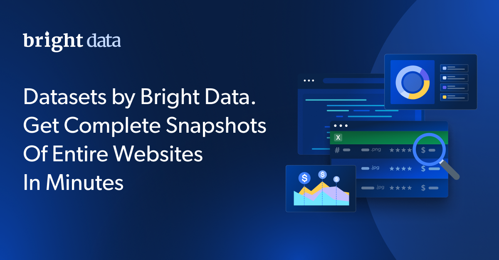

# 6sense 公司信息数据集样本

<h2>包含 1,886 条记录的样本数据集</h2>

此 **6sense 公司信息数据集样本**包含 **1,886 条记录**，并使用 **Bright Data API** 提取。

## 数据点

| 字段名称 | 描述 |
|------------|-------------|
| `name` | 公司的官方名称。 |
| `about` | 公司使命或服务的简要描述。 |
| `num_employees` | 公司员工人数估算值。 |
| `type` | 公司的类型，例如私营或上市公司。 |
| `industries` | 公司所处的行业，以数组格式列出。 |
| `techstack_arr` | 公司使用的技术和工具数组。 |
| `country_code` | 表示公司总部所在地的 ISO 国家/地区代码。 |
| `website` | 公司的官方网站 URL。 |
| `social_media_urls` | 公司社交媒体账号的 URL。 |
| `company_news` | 与公司相关的近期新闻报道或动态。 |
| `last_updated` | 公司信息最近更新的日期和时间。 |
| `url` | 指向公司在 6sense 平台上资料页面的 URL。 |
| `logo` | 公司官方徽标图片的 URL。 |
| `location` | 公司总部的完整地址。 |
| `region` | 公司所在的地理区域，例如北美或欧盟。 |
| `id` | 公司在数据集中的唯一标识符。 |
| `slintel_resources` | Slintel 提供的与公司相关的其他资源或参考信息。 |
| `stock_symbol` | 代表公司的股票代码（如适用）。 |

## 使用场景

### 1. 市场研究与分析
利用全面的公司资料开展市场研究和竞争分析，识别各行业的趋势与机遇。

### 2. 潜在客户开发与外联
利用详细的公司数据改进潜在客户开发策略并设计精准的外联活动，从而提高转化率。

### 3. 商业智能与战略
将公司信息集成到商业智能工具中，以获得战略洞察、优化运营并推动增长。

## 文件格式

该数据集提供多种格式：
- **CSV**（此样本中包含）
- **JSON**
- **NDJSON**
- **JSON Lines**
- **Parquet**
- **压缩格式 (.gz)**

## 交付方式

- **电子邮件**
- **API 下载**
- **Webhook**
- **Amazon S3**
- **Google Cloud Storage**
- **Microsoft Azure**
- **Snowflake**
- **SFTP**

## 更新频率

数据集可按多种周期更新：
- **一次性**（仅交付一次）
- **每日**
- **每周**
- **每月**
- **每季度**
- **自定义周期**

## 数据扩充

根据你的具体需求，通过添加额外数据点来扩充数据集。请联系我们，了解自定义数据扩充选项。

**[获取完整的 6sense 公司信息数据集](https://www.bright.cn/products/datasets/6sense)**

---

## 面向研究人员和非政府组织的免费访问

Bright Initiative 为致力于环境和社会事业的学术研究人员、非政府组织和非营利组织免费提供 **[网页爬虫工具 API](https://www.bright.cn/products/web-scraper)** 和 **[即用型数据集](https://www.bright.cn/products/datasets)**。 

请访问 [brightinitiative.com](https://brightinitiative.com) 申请免费访问权限。
